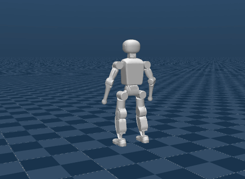

# Booster K1 Dance and Fight (`boosterdeploy`)



Source: https://github.com/BoosterRobotics/booster_deploy (Apache-2.0: the policies, the
clips, whose origin it does not state, and the deploy settings) · robot model:
https://github.com/BoosterRobotics/booster_assets (BSD-3-Clause)

A Booster K1 humanoid tracking two clips with Booster Robotics' own BeyondMimic policies,
the ones `scripts/deploy.py --task <name>` runs on the robot and in MuJoCo. Each scene
plays its clip from the start and starts it over at the end.

| Scene | booster_deploy task | Clip |
|---|---|---|
| `K1 MJ Dance` | `k1_mj2` | `k1_mj2_seg1.npz`: 25.2 s, the last 3.5 s standing still |
| `K1 Fight` | `k1_fight` | `k1_fight_final_deploy.npz`: 12.0 s, the last 3 s standing still |

booster_deploy's other policies are left out: its T1 and T2 dances, which run on other
robots, each with its own model and gains, and its walking policies (`k1_walk`, `t1_walk`,
`t2_walk`), which read a history of observations and filter their actions.

## Run

```sh
uv run msp run boosterdeploy
```

The build clones booster_deploy and booster_assets into `.cache/` at pinned commits; set
`MJSWAN_BOOSTER_DEPLOY_ROOT` or `MJSWAN_BOOSTER_ASSETS_ROOT` to point at a checkout you
already have. It replays each clip through mjlab once, into `.cache/boosterdeploy/`.

| From | Used as |
|---|---|
| booster_deploy `tasks/beyond_mimic/robots/k1/__init__.py` | each scene's PD gains, effort limits, rest pose and timing, imported from the checkout |
| booster_deploy `booster_deploy/robots/k1.py` | the model's joint order, and Isaac Lab's that the policies were trained in |
| booster_deploy `tasks/beyond_mimic/robots/k1/models/*.pt` | the policies (TorchScript, 119 → 22), rebuilt as ONNX |
| booster_deploy `tasks/beyond_mimic/robots/k1/motions/*.npz` | the clips, replayed through mjlab into the model's joint and body order |
| booster_assets `robots/K1/K1_22dof.xml` | the robot, without its floor, lights and motors |
| mjlab's tracking task | the observations, the motion command and the terminations |

Each scene runs what booster_deploy's MuJoCo controller runs: booster_assets' MJCF with
its own solver options, physics at 500 Hz and the policy at 50 Hz, and a PD torque every
physics step, clipped to the task's effort limit. The ONNX permutes the observation into
Isaac Lab's joint order and the action back out of it, and matches the TorchScript
checkpoint to float32 rounding. Over each whole clip in mjlab, the port tracks as
booster_deploy's own MuJoCo run does:

| | MJ dance: booster_deploy / here | Fight: booster_deploy / here |
|---|---|---|
| Mean anchor position error | 0.164 / 0.147 m | 0.295 / 0.316 m |
| Mean joint position error (norm over 22 joints) | 0.553 / 0.549 rad | 1.507 / 1.501 rad |
| Largest tilt | 24.1 / 24.1° | 34.9 / 35.0° |

## What the policy reads

mjlab's tracking observation without state estimation, one frame, no history, in the
model's joint order:

| Term | Width | Source |
|---|---|---|
| `command` | 44 | the clip's joint positions and velocities |
| `motion_anchor_ori_b` | 6 | the clip's trunk orientation in the robot's trunk frame, two columns of its matrix |
| `base_ang_vel` | 3 | the trunk's gyro |
| `joint_pos` | 22 | `joint_pos_rel` |
| `joint_vel` | 22 | `joint_vel_rel` |
| `actions` | 22 | the previous action |

## What differs from upstream

- **The clip starts over.** At its last frame the episode resets to its first, as mjlab's
  play does; booster_deploy holds the last frame.
- **Each episode starts on the clip's first frame.** booster_deploy starts the robot at
  its rest pose, 0.57 m up, wherever the clip begins.
- **mjlab's tracking terminations.** The episode resets when the trunk's or an ankle's or
  hand's height is 0.25 m off the clip's, or the trunk's tilt is off it by 0.8 in
  projected gravity. booster_deploy has only a safety stop, once the tilt is 60° off the
  clip's.
