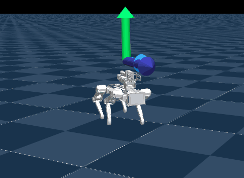

# XGO Walking (`luwu`)



Source: https://github.com/LuwuDynamics/luwu_mjlab (Apache-2.0, robot models included) ·
policies from https://huggingface.co/robomotic/XGO (Apache-2.0)

Three robot dogs from Luwu Dynamics walking to velocity commands, each with the policy
robomotic trained with luwu_mjlab and published on the Hub. The command is resampled every
3 to 8 s, as upstream's play config draws it, and the joystick panel can take over.

| Scene | What it does |
|---|---|
| `Mini2S-Walk-Flat` | the palm-sized Mini2S, a 12-joint dog with a 3-joint arm on its back, trotting |
| `Mini2SW-Walk-Flat` | the Mini2SW, a Mini2S with fixed wheels on its calves as feet |
| `Lite3-Walk-Flat` | the larger Lite3, with a 2-joint arm |

Left out: `Mini2S-Turn-Flat` and `Mini2SW-Turn-Flat`, the get-up policies. Their action
term, upstream's `HeldJointPositionActionCfg`, sets each joint's target to where the joint
is for the first second of an episode, on every physics substep, which no policy wrapper
can do at the control rate.

## Run

```sh
uv run msp run luwu
```

The build clones the repository into `.cache/` at a pinned commit and downloads the three
`policy.onnx` files from the Hub at a pinned revision; set `MJSWAN_LUWU_ROOT` to point at a
checkout you already have. Upstream runs from source as the top-level package `src`, so
[`upstream.py`](upstream.py) puts the checkout first on `sys.path` and imports
`src.tasks`, which registers every task.

| Scene | Upstream task (`play=True`) | Policy on `robomotic/XGO` |
|---|---|---|
| `Mini2S-Walk-Flat` | `Mini2S-Walk-Flat` | `mini2s_walk/policy.onnx` (56 → 15) |
| `Mini2SW-Walk-Flat` | `Mini2SW-Walk-Flat` | `mini2sw_walk/policy.onnx` (56 → 15) |
| `Lite3-Walk-Flat` | `Lite3-Walk-Flat` | `lite3_walk/policy.onnx` (53 → 14) |

Each task gives the scene, the observations, the action term, the terminations and the
startup randomization. Each export's mjlab metadata gives the joint order and the rest
pose. The Hub repo's `params/env.yaml` beside each policy is the run's training config,
and its `model_1499.pt` the same policy before export.

## What the policy reads

Seven terms, one frame, no history:

| Term | Width | Source |
|---|---|---|
| `base_ang_vel` | 3 | the `imu_ang_vel` sensor |
| `projected_gravity` | 3 | `projected_gravity_b` |
| `command` | 3 | the `twist` command |
| `phase` | 2 | sin and cos of a 0.4 s gait clock, zero while the command is below 0.1 |
| `joint_pos` / `joint_vel` | 15 each (Lite3: 14) | `joint_pos_rel` / `joint_vel_rel` |
| `actions` | 15 (Lite3: 14) | the previous action |

The policies drive the arm joints too, holding the arm folded while the legs trot.

## How it behaves

The Lite3 wags its yaw as it trots, about 0.5 rad/s either way, and turns slowly off its
heading. It does the same in mjlab with upstream's own config, so it is the policy's.

## What differs from upstream

- **The gait clock is a command term.** Upstream's `phase` reads `env.episode_length_buf`,
  which the browser does not serve. [`_gait_clock.py`](../_gait_clock.py) counts control
  steps in a `gait_clock` command that restarts on reset, and the observation reads its
  `step_count` and the twist's `vel_command_b`.
- **The twist is mjlab 1.6's.** Upstream ships its own copy of mjlab 1.2's
  `UniformVelocityCommandCfg`, under the same name, without the fields mjswan's binding of
  that name traces. [`main.py`](main.py) rebuilds it as mjlab's class with the same
  settings. Upstream's copy also zeroes a resampled command whose norm is under 0.1; the
  rebuilt one keeps it as drawn, so such a command reaches the policy with `phase` at
  zero.
- **The joystick leaves the standing gate alone.** mjswan feeds a traced term the
  command's own state, not the joystick's override, so with the joystick on, `phase` is
  zero while the resampled command is below 0.1, whatever the sliders say.
- **mjlab 1.6.0.** Upstream pins `mjlab==1.2.0`. Its imports of `XmlPositionActuatorCfg`,
  `XmlMotorActuatorCfg`, `DelayedActuatorCfg` and `update_assets`, and its `CollisionCfg`
  without the fields 1.6.0 made required, are shimmed in [`_compat.py`](../_compat.py)
  while `upstream.py` imports it.
- **No lags.** Training delays the joint feedback by 1 to 2 control steps and the
  actuator commands by 1 to 2 physics steps; play zeroes both, as here.
- **No encoder bias.** mjlab's play config draws a ±0.04 rad bias per joint at startup;
  the browser applies the policy config's `encoder_bias` instead, and the exports carry
  none.
- **One randomized robot, not a population.** The CoM offset on `base` and the foot
  friction (0.2 to 3.0) are drawn once from the browser's seeded PRNG, where mjlab draws
  them per env.
- **No terrain re-draw.** Play adds `randomize_terrain`, which picks a sub-terrain per
  reset; the flat tasks have one plane, so `main.py` drops it.
