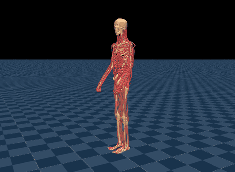

# muscle-supermimic (`msm`)



Source: https://github.com/kaibohex/muscle-supermimic/tree/d73bbcb866da83bef186a730547ab09ecb96bd3d
(Apache-2.0, its SuperMimic port MIT) ·
policies from https://huggingface.co/Beanpow/muscle-supermimic (no license stated) ·
MS-Human-700 from https://github.com/LNSGroup/MS-Human-700 (Apache-2.0) ·
MyoFullBody from `musclemimic-models` 1.0.6 (Apache-2.0, its arm and hand
non-commercial) · clips: AMASS KIT motions retargeted by MuscleMimic (non-commercial
research, no redistribution), see [License](#license) ·
project page: https://muscle-supermimic.beanpow.top/

> Q. Liao et al.
> [SuperMimic: Scaling Humanoid Whole-Body Control with One Differentiable World Model](https://arxiv.org/abs/2610.28480).
> CoRL 2026. arXiv:2610.28480.

Two whole-body musculoskeletal humans, each driven by its own SuperMimic policy, setting
the excitation of every muscle at 100 Hz to track motion-capture clips. The viewer's
motion picker lists the 32 clips of upstream's own browser demo under its groups: walking
forward, backward, slowly, at a medium pace and fast, running, turning left and right,
circling either way, and walking with a support. A clip plays from its first frame, in
the state upstream's reset writes, and starts over after its last.

| Scene | Body | Policy |
|---|---|---|
| MS-Human-700 | MS-Human-700 with locked hands: 33 joint DoF, 694 muscles | `model_016000` |
| MyoFullBody | MuscleMimic's MyoFullBody, fingers disabled: 31 joint DoF, 354 muscles | `model_016000` |

## Run

```sh
uv sync --extra msm         # MyoFullBody's model, musclemimic-models 1.0.6
uv run msp run msm
```

The first build clones muscle-supermimic and its MS-Human-700 submodule into
`.cache/msm/` at pinned commits (or reads the checkouts `MJSWAN_MSM_ROOT` and
`MS_HUMAN_700_ROOT` point at), downloads both checkpoints from the Hub at a pinned
revision (322 MB and 258 MB), and converts each policy's decoder and each clip beside
them. The clips take 63 MB and 66 MB of the build; the browser fetches one when it is
picked.

| Policy | Upstream task | Checkpoint |
|---|---|---|
| MS-Human-700 `model_016000` | `Mjlab-SuperMimic-Flat-MS-Human-700-Locked-Hands` | `mshuman700/kit_mm_euler_sgc100/model_016000.pt` |
| MyoFullBody `model_016000` | `Mjlab-SuperMimic-Flat-MyoFullBody` | `myofullbody/kit_n4096_euler_sgc100/model_016000.pt` |

| From `muscle-supermimic` | Used as |
|---|---|
| `src/muscle_supermimic/` | the tasks' play configs and bodies, the motion library, the kinematics and the policy network, imported from the checkout |
| `docs/website/demo/data/<body>/clips/` | each clip's reference qpos per frame, rebuilt into an mjlab motion |
| `docs/website/demo/data/<body>/init.bin` | the state upstream's reset writes, each motion's first frame |
| `docs/website/demo/data/<body>/policy.onnx.gz` | the decoder upstream exported, which the export here is checked against |
| `docs/website/demo/main.mjs` | the picker's groups, its `KINDS` |
| `src/muscle_supermimic/tasks/tracking/scripts/export_web.py` | the decoder's export, weight matrices stored as float16 |

Left out: `Mjlab-SuperMimic-Flat-MS-Human-700`, the body with free hands, which has no
published checkpoint; the `model_010000` checkpoints of both runs, earlier checkpoints of
the same policies; and `myofullbody/kit_n4096_euler/model_012000.pt`, an earlier
MyoFullBody run on the same task, which the model card says collapsed after it.

## What the policy reads

The policy is a motion encoder over the reference alone and a decoder over the body's
state, `sigmoid(dec(z, normalize(obs)))`. Nothing the body does reaches the encoder, so,
as upstream's demo does, the build evaluates it once for every frame of the clips (18150
per body) and the browser runs the decoder alone: `latent[1, 32]` and `policy[1, N]` to
the excitations, with N 3819 on MS-Human-700 and 2141 on MyoFullBody.

Each clip is an mjlab motion `.npz`: mjlab's arrays, every body's pose and velocity per
frame as `csv_to_npz` records them, and two more, a row per frame, that mjswan's tracking
command serves at the current frame. `latent` is the encoder's; `frames_left` counts the
frames after the current one, for upstream's `motion_end`.

| Term | Width | Source |
|---|---:|---|
| `latent` | 32 | the selected clip's `latent` at the current frame |
| `root_pos`, `root_vel` | 5, 6 | the free joint's `qpos` (height, quaternion) and `qvel` |
| `joint_pos`, `joint_vel` | 71 or 82 each | every joint, the coupled ones on their `<equality>` polynomials, upstream's own code |
| `muscle_length`, `_velocity`, `_force` | 3 per muscle | `actuator_length`, `actuator_velocity`, `actuator_force` |
| `muscle_excitation`, `_activation` | 2 per muscle | the last action, `act` |
| `touch` | 4 | the foot contact sensor's vertical force, as mjlab reads it |
| `site_rpos`, `_rangles`, `_rvel` | 48, 48, 96 | the 17 tracked bodies relative to the first: `xpos`, `xmat`, `cvel`, `subtree_com` |

| Compared | MS-Human-700 | MyoFullBody |
|---|---:|---:|
| latents vs upstream's demo, 18150 frames | 8.9e-05 | 4.5e-05 |
| decoder vs upstream's exported one, 16 rows | 1.4e-06 | 2.1e-06 |
| the clips' tracked bodies vs upstream's kinematics (m) | 7.2e-07 | 7.2e-07 |
| a reset's state vs upstream's (`init.bin`), 32 clips: in mjlab, qpos / qvel | 6.0e-08 / 7.5e-08 | 1.2e-07 / 6.0e-08 |
| same, as mjswan's tracking command writes it | 6.0e-08 / 0 | 6.0e-08 / 0 |
| the latent the policy sees each step vs the demo's for that frame, 32 clips | 8.9e-05 | 4.5e-05 |
| observation vs upstream's, on its own play rollouts: muscle length (m) | 3.3e-02 | 5.0e-02 |
| same: muscle velocity (m/s) / force (N) | 9.4e-02 / 482 | 0.18 / 695 |
| same: tracked-body positions (m) / angles (rad) / velocities | 1.0e-02 / 5.1e-03 / 0.10 | 3.4e-03 / 1.2e-02 / 0.30 |
| same: every other term | 1.2e-06 | 1.3e-06 |
| traced graphs vs these terms in mjlab, 16 steps (`scripts/parity.py msm`) | 4.6e-07 | 4.6e-07 |

The rollouts are two clips per body played to their end by upstream's own env and
policy: MS-Human-700's first and its counterclockwise circle, MyoFullBody's first and a
run. Fed this observation instead, the policies track all 32 clips to their last frame in
mjlab, each episode ended by `motion_end` after as many steps as upstream's. The latent
check runs those episodes: the latent is the clip's own row at the step count, and the
rows next to it differ from it by at least 7.9e-04.

## What differs from upstream

- **The muscles and the tracked bodies are read off MuJoCo.** Upstream computes them in
  torch, from the state with every coupled joint (knee, shoulder rhythm, lumbar spine)
  exactly on its `<equality>` polynomial, where the simulated joint sits a little off it.
  Its torch replica of MuJoCo's tendons traces to thousands of graph nodes, too slow for
  a browser at 100 Hz, while MuJoCo computes the same quantities every step. The table
  above has the difference; the joint positions and velocities are upstream's own.
- **The clips are upstream demo's.** MuscleMimic's retargeted clips are a gated dataset,
  so the build rebuilds the 32 held-out KIT clips of upstream's browser demo, three of
  each kind, from the reference poses in its files. Each becomes an mjlab motion, replayed
  in MuJoCo as mjlab's `csv_to_npz` replays a clip, with upstream's reference velocities
  and, at its first frame, the state upstream's reset writes. The build checks the
  latents it evaluates against the demo's, and the tracked bodies against upstream's
  kinematics.
- **mjlab's `MotionCommand` replaces upstream's**, and mjswan runs it as its own tracking
  command, the viewer picking the clip; upstream's play config replays the first.
  - Like upstream's, and unlike mjlab's own, it keeps the frame a reset writes through
    the step the reset lands in, so the policy sees frame n at step n, and it writes the
    joints unclipped: upstream's reset leaves a coupled joint up to 1e-4 rad past its
    range, on its polynomial.
  - The latent and the clip's end come from the clip's `latent` and `frames_left`.
  - The terminations are upstream's four: the clip's last frame as a time-out, and the
    mean tracked-body, root position and root orientation deviations past 1 m or 1 rad.
    The deviations read the reference the command serves, the root's pose and the
    tracked bodies' positions, at the frame the policy observed: the command moves on
    after the terminations run, where upstream compares with the next frame, 10 ms on.
  - On MyoFullBody it tracks the free joint's body, `Full Body`, in place of upstream's
    first, the pelvis inside it: the same origin, turned. mjlab and mjswan write the first
    tracked body's pose into the free joint.
  - Each clip's first frame holds the root's angular velocity in the root's own frame,
    since mjswan writes it into the free joint's velocity unrotated, where mjlab rotates
    it out of the world's; the command here writes it the same way. Both resets are then
    upstream's.
- **In the browser, a clip picked or reset in the viewer runs a step behind.** mjswan's
  tracking command keeps a reset's frame for one more step when the reset comes between
  steps, so that episode sees each latent one control step late, and lasts a step longer.
  The episodes after it, which `motion_end` starts, match upstream's frame for frame.
- **The muscle action runs as mjswan's.** Upstream's `MuscleExcitationAction` writes each
  excitation, clipped to [0, 1], to its muscle's `ctrl` through the tendon's effort
  target, which mjswan does not run; under the name of mjswan's muscle action, which in
  its `excitation` mode writes the same `ctrl`, mjlab still builds upstream's term.
- **The rewards are dropped**: they read upstream's command, and play computes none.
- **The decoder's weights are float16**, cast back to float32 as the graph loads, as in
  upstream's demo: 21 MB and 14 MB.
- **Browser behaviour is not asserted.** Parity proves each graph matches mjlab under
  `mujoco_warp`; the browser runs MuJoCo's WASM build.

## License

The code is Apache-2.0, and MS-Human-700 and `musclemimic-models` are too, but:

- The checkpoints state no license; the model card calls them private.
- MyoFullBody's arm and hand derive from MoBL-ARMS, released for non-commercial use only.
- The clips are AMASS KIT motions, whose license allows non-commercial research only and
  no redistribution, retargeted to MyoFullBody by MuscleMimic and from there onto
  MS-Human-700 by upstream. The build bakes the latents and reference poses of 32 of them
  into its motions.

So the task stays off this repository's site, and only its author publishes it.
