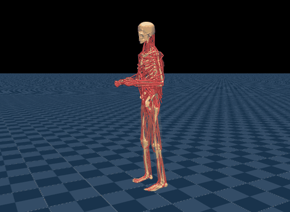

# muscle-supermimic (`msm`)



Source: https://github.com/kaibohex/muscle-supermimic/tree/d73bbcb866da83bef186a730547ab09ecb96bd3d
(Apache-2.0, its SuperMimic port MIT) ·
policies from https://huggingface.co/Beanpow/muscle-supermimic (no license stated) ·
MS-Human-700 from https://github.com/LNSGroup/MS-Human-700 (Apache-2.0) ·
MyoFullBody from `musclemimic-models` 1.0.6 (Apache-2.0, its arm and hand
non-commercial) · clips: [100STYLE](https://ianxmason.github.io/100style/) (Ian Mason,
CC BY 4.0), retargeted here with MuscleMimic's GMR fork
[gmr_plus](https://github.com/amathislab/gmr_plus/tree/1b4eb9864360fa822b1290f34592da6393a4d496)
(MIT), see [License](#license) · project page: https://muscle-supermimic.beanpow.top/

> Q. Liao et al.
> [SuperMimic: Scaling Humanoid Whole-Body Control with One Differentiable World Model](https://arxiv.org/abs/2610.28480).
> CoRL 2026. arXiv:2610.28480.

Two whole-body musculoskeletal humans, each driven by its own SuperMimic policy, setting
the excitation of every muscle at 100 Hz to track motion-capture clips. The viewer's
motion picker lists twelve 8 s clips of 100STYLE under two groups: walking forward (the
neutral style twice, and ArmsBehindBack, ArmsBySide, Depressed, DuckFoot, HandsInPockets,
LookUp, Monk, Old and PigeonToed) and walking sideways (the neutral style), each named by
its style, its gait and where it starts in its BVH. A clip plays from its first frame, in
the state upstream's reset writes, and starts over after its last. Its reference is drawn
as upstream's demo draws it, a translucent blue ghost at the clip's own place; nothing
the policy reads places the body relative to it, so the body drifts from it as a clip
goes on.

| Scene | Body | Policy |
|---|---|---|
| MS-Human-700 | MS-Human-700 with locked hands: 33 joint DoF, 694 muscles | `model_016000` |
| MyoFullBody | MuscleMimic's MyoFullBody, fingers disabled: 31 joint DoF, 354 muscles | `model_016000` |

## Run

```sh
uv sync --extra msm         # MyoFullBody's model, musclemimic-models 1.0.6
uv run msp run msm
```

The first build clones muscle-supermimic and its MS-Human-700 submodule into
`.cache/msm/` at pinned commits (or reads the checkouts `MJSWAN_MSM_ROOT` and
`MS_HUMAN_700_ROOT` point at), downloads both checkpoints from the Hub at a pinned
revision (322 MB and 258 MB), and converts each policy's decoder beside them. It then
downloads 100STYLE's BVH archive from Zenodo, checked against the checksum the record
lists, keeps the BVHs the clips cut from (or reads the directory `MJSWAN_100STYLE_ROOT`
points at), checks out gmr_plus's Python package alone (its robot assets are 1.4 GB),
and retargets each clip, onto MyoFullBody and from there onto MS-Human-700. The archive
is 1.5 GB, of which the clips' BVHs are 76 MB. The clips take 33 MB and 34 MB of the
build; the browser fetches one when it is picked.

The whole build uploads 118 MB, over the 100 MB that mjswan Cloud takes, so `PARTS`
splits it into two uploads, one body each, built by their own IDs
(`uv run msp build msm-mshuman`):

| Part | Scene | Upload | On mjswan Cloud |
|---|---|---:|---|
| `msm-mshuman` | MS-Human-700 | 65 MB | not yet |
| `msm-myofullbody` | MyoFullBody | 53 MB | not yet |

| Policy | Upstream task | Checkpoint |
|---|---|---|
| MS-Human-700 `model_016000` | `Mjlab-SuperMimic-Flat-MS-Human-700-Locked-Hands` | `mshuman700/kit_mm_euler_sgc100/model_016000.pt` |
| MyoFullBody `model_016000` | `Mjlab-SuperMimic-Flat-MyoFullBody` | `myofullbody/kit_n4096_euler_sgc100/model_016000.pt` |

| From `muscle-supermimic` | Used as |
|---|---|
| `src/muscle_supermimic/` | the tasks' play configs and bodies, the motion library, the kinematics and the policy network, imported from the checkout |
| `docs/website/demo/data/<body>/policy.onnx.gz` | the decoder upstream exported, which the export here is checked against |
| `src/muscle_supermimic/tasks/tracking/scripts/export_web.py` | the decoder's export, weight matrices stored as float16 |
| `src/muscle_supermimic/tasks/tracking/scripts/retarget_myofullbody.py` | its `Retargeter`, which takes each clip from MyoFullBody onto MS-Human-700, and the foot geoms each clip is set on the floor by |

| From `gmr_plus` | Used as |
|---|---|
| `general_motion_retargeting/motion_retarget.py` | the IK that fits MyoFullBody to each BVH frame, two passes per frame |
| `general_motion_retargeting/utils/soma.py` | the BVH reader: SOMA's BVHs have 100STYLE's axes and units |
| `general_motion_retargeting/ik_configs/bvh_soma_to_myofullbody.json` | the IK costs, copied into `style100.MATCH` |

Left out: `Mjlab-SuperMimic-Flat-MS-Human-700`, the body with free hands, which has no
published checkpoint; the `model_010000` checkpoints of both runs, earlier checkpoints of
the same policies; and `myofullbody/kit_n4096_euler/model_012000.pt`, an earlier
MyoFullBody run on the same task, which the model card says collapsed after it.

## What the policy reads

The policy is a motion encoder over the reference alone and a decoder over the body's
state, `sigmoid(dec(z, normalize(obs)))`. Nothing the body does reaches the encoder, so,
as upstream's demo does, the build evaluates it once for every frame of the clips (9564
per body) and the browser runs the decoder alone: `latent[1, 32]` and `policy[1, N]` to
the excitations, with N 3819 on MS-Human-700 and 2141 on MyoFullBody.

Each clip is an mjlab motion `.npz`: mjlab's arrays, every body's pose and velocity per
frame as `csv_to_npz` records them, and two more, a row per frame, that mjswan's tracking
command serves at the current frame. `latent` is the encoder's; `frames_left` counts the
frames after the current one, for upstream's `motion_end`.

| Term | Width | Source |
|---|---:|---|
| `latent` | 32 | the selected clip's `latent` at the current frame |
| `root_pos`, `root_vel` | 5, 6 | the free joint's `qpos` (height, quaternion) and `qvel` |
| `joint_pos`, `joint_vel` | 71 or 82 each | every joint, the coupled ones on their `<equality>` polynomials, upstream's own code |
| `muscle_length`, `_velocity`, `_force` | 3 per muscle | `actuator_length`, `actuator_velocity`, `actuator_force` |
| `muscle_excitation`, `_activation` | 2 per muscle | the last action, `act` |
| `touch` | 4 | the foot contact sensor's vertical force, as mjlab reads it |
| `site_rpos`, `_rangles`, `_rvel` | 48, 48, 96 | the 17 tracked bodies relative to the first: `xpos`, `xmat`, `cvel`, `subtree_com` |

| Compared | MS-Human-700 | MyoFullBody |
|---|---:|---:|
| decoder vs upstream's exported one, 16 rows | 1.4e-06 | 2.1e-06 |
| the clips' tracked bodies vs upstream's kinematics (m) | 1.4e-06 | 1.4e-06 |
| observation vs upstream's, on its own play rollouts: muscle length (m) | 3.3e-02 | 5.0e-02 |
| same: muscle velocity (m/s) / force (N) | 9.4e-02 / 482 | 0.18 / 695 |
| same: tracked-body positions (m) / angles (rad) / velocities | 1.0e-02 / 5.1e-03 / 0.10 | 3.4e-03 / 1.2e-02 / 0.30 |
| same: every other term | 1.2e-06 | 1.3e-06 |
| traced graphs vs these terms in mjlab, 16 steps (`scripts/parity.py msm`) | 4.6e-07 | 4.6e-07 |

The rollouts are upstream's own env and policy playing two of its demo's clips per body
to their end. The observation does not depend on which clips the build ships, so the
rows stand for 100STYLE's.

## What differs from upstream

- **The muscles and the tracked bodies are read off MuJoCo.** Upstream computes them in
  torch, from the state with every coupled joint (knee, shoulder rhythm, lumbar spine)
  exactly on its `<equality>` polynomial, where the simulated joint sits a little off it.
  Its torch replica of MuJoCo's tendons traces to thousands of graph nodes, too slow for
  a browser at 100 Hz, while MuJoCo computes the same quantities every step. The table
  above has the difference; the joint positions and velocities are upstream's own.
- **The clips are 100STYLE's, not upstream's.** Upstream trains and demos on AMASS KIT
  clips, whose license allows no redistribution, so the build retargets 100STYLE's
  instead (`style100.py`), clips the policies never saw in training:
  - Twelve clips are kept: those both policies play from their reset to their end in the
    browser, and on through the clip's restart, with no termination but the clip's end.
    The policies learned on KIT walks at 0.4 to 0.7 m/s, and backwards only in straight
    lines, while 100STYLE's actor crosses a 4.5 m square and turns at its edges. Each
    clip starts where the dataset's `Frame_Cuts.csv` says its capture does, but the
    neutral forward walk's, 8 s on and at 69 s, where it turns least. Of the other clips
    tried, these each end on a deviation within their 8 s: the runs (1 to 1.3 m/s), the
    backward walks and the other sideways ones, and the forward walks of Akimbo,
    ArmsAboveHead, ArmsFolded, Elated, OnPhoneRight, Proud, Robot, Strutting and Zombie.
  - GMR fits MyoFullBody to each BVH frame at 30 fps with gmr_plus's IK costs for SOMA's
    BVH onto MyoFullBody. The scales and offsets are made from the two rest poses rather
    than tuned: 100STYLE's T-pose and MyoFullBody in gmr_plus's (both shoulders
    elevated 90°), aligned the way gmr_plus's shape fitting aligns SMPL-H; one scale for
    the legs, which the torso and the root's travel follow, and one for the arms.
  - Each clip is then set down so that the feet stand on the floor at its median frame,
    and upstream's `Retargeter` takes it on to MS-Human-700, as upstream takes its KIT
    clips.
  - Each becomes an mjlab motion, replayed in MuJoCo as mjlab's `csv_to_npz` replays a
    clip, with upstream's reference velocities and, at its first frame, the state
    upstream's reset writes: the reference with its joints clamped to their ranges. The
    build checks the tracked bodies against upstream's kinematics.
- **mjlab's `MotionCommand` replaces upstream's**, and mjswan runs it as its own tracking
  command, the viewer picking the clip; upstream's play config replays the first.
  - Like upstream's, and unlike mjlab's own, it keeps the frame a reset writes through
    the step the reset lands in, so the policy sees frame n at step n, and its
    `hold_reset_frame` tells mjswan to. It writes the joints unclipped: upstream's reset
    leaves a coupled joint up to 1e-4 rad past its range, on its polynomial.
  - The latent and the clip's end come from the clip's `latent` and `frames_left`.
  - The terminations are upstream's four: the clip's last frame as a time-out, and the
    mean tracked-body, root position and root orientation deviations past 1 m or 1 rad.
    The deviations read the reference the command serves, the root's pose and the
    tracked bodies' positions, at the frame the policy observed: the command moves on
    after the terminations run, where upstream compares with the next frame, 10 ms on.
  - On MyoFullBody it tracks the free joint's body, `Full Body`, in place of upstream's
    first, the pelvis inside it: the same origin, turned. mjlab and mjswan write the first
    tracked body's pose into the free joint.
- **The muscle action runs as mjswan's.** Upstream's `MuscleExcitationAction` writes each
  excitation, clipped to [0, 1], to its muscle's `ctrl` through the tendon's effort
  target, which mjswan does not run; under the name of mjswan's muscle action, which in
  its `excitation` mode writes the same `ctrl`, mjlab still builds upstream's term.
- **The rewards are dropped**: they read upstream's command, and play computes none.
- **The decoder's weights are float16**, cast back to float32 as the graph loads, as in
  upstream's demo: 21 MB and 14 MB.
- **Browser behaviour is not asserted.** Parity proves each graph matches mjlab under
  `mujoco_warp`; the browser runs MuJoCo's WASM build.

## License

The code is Apache-2.0, and MS-Human-700 and `musclemimic-models` are too, but:

- The checkpoints state no license; the model card calls them private.
- MyoFullBody's arm and hand derive from MoBL-ARMS, released for non-commercial use only.
- The clips are 100STYLE's, CC BY 4.0. gmr_plus, which retargets them, is MIT and runs
  at build time only.

Each scene carries, as `LICENSE.<component>` and `NOTICE.<component>`:

| Component | Files | For |
|---|---|---|
| `muscle-supermimic` | upstream's `LICENSE` (Apache-2.0) and `NOTICE` | the code the scene's graphs and decoder are made from |
| `muscle-supermimic-checkpoint` | a `NOTICE` | where the policy comes from, and that its model card states no license |
| `100style` | the CC BY 4.0 text, and a `NOTICE` | the credit and how the clips were changed |
| `musclemimic_models` | the package's `LICENSE` (Apache-2.0) and `NOTICE`, MyoFullBody's scene only | the body, its `NOTICE` saying the arm and hand are for non-commercial use only |
| `MS-Human-700` | upstream's `LICENSE` (Apache-2.0), MS-Human-700's scene only, found beside the model | the body |

So the task stays off this repository's site, and only its author publishes it.
