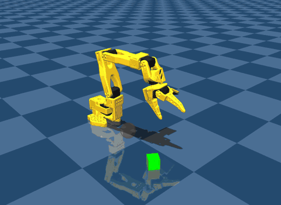

# MuJoCo Playground (`reaf`)



Source: [MuJoCo Playground](https://github.com/google-deepmind/mujoco_playground) (Apache-2.0),
built on [reaf-sim](https://github.com/google-deepmind/reaf-sim) (Apache-2.0) ·
policies from [ttktjmt/so101-pick-cube](https://huggingface.co/ttktjmt/so101-pick-cube) and
[ttktjmt/so101-pick-cube-vision](https://huggingface.co/ttktjmt/so101-pick-cube-vision),
trained with mjswan's
[`examples/train/so101_pick_cube.py`](https://github.com/ttktjmt/mjswan/blob/main/examples/train/so101_pick_cube.py),
and [ttktjmt/cartpole-balance](https://huggingface.co/ttktjmt/cartpole-balance),
[ttktjmt/cartpole-swing-up](https://huggingface.co/ttktjmt/cartpole-swing-up),
[ttktjmt/cartpole-balance-vision](https://huggingface.co/ttktjmt/cartpole-balance-vision),
[ttktjmt/trossen-pick-cube](https://huggingface.co/ttktjmt/trossen-pick-cube),
[ttktjmt/trossen-pick-cube-vision](https://huggingface.co/ttktjmt/trossen-pick-cube-vision) and
[ttktjmt/g1-whole-body-tracking-100style-neutral-fw](https://huggingface.co/ttktjmt/g1-whole-body-tracking-100style-neutral-fw),
trained with [`train.py`](train.py) ·
the SO-101 (Apache-2.0), the Trossen WXAI, the ALOHA table and the Unitree G1
(BSD-3-Clause) from [MuJoCo Menagerie](https://github.com/google-deepmind/mujoco_menagerie) ·
`G1WholeBodyTracking`'s clip is [100STYLE](https://ianxmason.github.io/100style/)'s
neutral forward walk (Ian Mason, CC BY 4.0), retargeted to the G1 here, see
[`motions/NOTICE.100style`](motions/NOTICE.100style)

MuJoCo Playground's RL environments, one scene each, named after the environment's ID in
Playground's `env_registry.py`. Each environment is also a part of its own, the build
that reaf-sim's documentation embeds on that environment's page.

| Scene | Part | What it does |
|---|---|---|
| `SO101PickCube` | `reaf-so101-pick-cube` | The SO-101 lifts a cube to a target that moves every 4 to 7 s, reading where the cube is. |
| `SO101PickCubeVision` | `reaf-so101-pick-cube-vision` | The same, finding the cube through its wrist camera, at 10 Hz. |
| `CartpoleBalance` | `reaf-cartpole-balance` | A cart keeps a pole upright, from close to upright, at 100 Hz. |
| `CartpoleSwingUp` | `reaf-cartpole-swing-up` | The cart swings the pole up from hanging down, then balances it. |
| `CartpoleBalanceVision` | `reaf-cartpole-balance-vision` | Balancing from the last three grayscale frames of a fixed camera, at 50 Hz. |
| `TrossenPickCube` | `reaf-trossen-pick-cube` | The Trossen WXAI's right arm lifts a cube on a table to a target that moves every 4 to 7 s, at 50 Hz. |
| `TrossenPickCubeVision` | `reaf-trossen-pick-cube-vision` | The same, finding the cube through its wrist camera. |
| `G1WholeBodyTracking` | `reaf-g1-whole-body-tracking` | The Unitree G1 walks and turns as 100STYLE's actor does, tracking a 20 s clip with its whole body, at 50 Hz. |

## Run

```sh
uv run msp run reaf                    # every environment
uv run msp run reaf-so101-pick-cube    # one of them
```

The first build fetches the robots and the table from MuJoCo Menagerie at a pinned commit into
`.cache/reaf/`, and each policy from the Hugging Face Hub at a pinned revision. The G1's
clip is in [`motions/`](motions/), converted as Playground's `csv_to_npz` converts it.

| From | Used as |
|---|---|
| Playground `tasks/manipulation/pick_cube` | the cube, the target and when it moves, the observations, the action scale, the resets |
| Playground `robots/so101/sim` | the servo dynamics identified on the real arm |
| Playground `_src/objects/assets/primitive/plane.xml` | the floor |
| Playground `tasks/dm_control_suite/cartpole`, `cartpole_vision` | the cart-pole, its observations and resets, the camera frames and when an episode ends |
| Playground `robots/trossen_wxai/sim`, `pick_cube/trossen_wxai` | the servos, the table and lights, the right arm's observations, action scale and resets |
| Menagerie `robotstudio_so101` | the SO-101 |
| Playground `tasks/whole_body/tracking` | the clip's conversion; the rest is mjlab's `Mjlab-Tracking-Flat-Unitree-G1`, which it restates |
| Menagerie `trossen_wxai`, `aloha` | the bimanual WXAI, the table's meshes |
| 100STYLE (Zenodo record 8127870), `Neutral/Neutral_FW.bvh` | `motions/100style_neutral_fw.csv`, by [`retarget_100style.py`](retarget_100style.py) |
| Hub `ttktjmt/so101-pick-cube` at `fcdf077` | `SO101PickCube`'s policy, trained on Playground 1.0.1 |
| Hub `ttktjmt/so101-pick-cube-vision` at `c1b4d11` | `SO101PickCubeVision`'s policy, 1800 of its 3000 iterations |
| Hub `ttktjmt/trossen-pick-cube` at `e0b52c5` | `TrossenPickCube`'s policy, all 1000 iterations on Playground 1.1.0 |
| Hub `ttktjmt/trossen-pick-cube-vision` at `8ca63be` | `TrossenPickCubeVision`'s policy, all 3000 iterations on Playground 1.1.0 |
| Hub `ttktjmt/g1-whole-body-tracking-100style-neutral-fw` at `f5633d2` | `G1WholeBodyTracking`'s policy, 5500 of its 30000 iterations on Playground 1.1.0 |
| Hub `ttktjmt/cartpole-balance` at `9a0d9f0`, `ttktjmt/cartpole-swing-up` at `75170d8`, `ttktjmt/cartpole-balance-vision` at `18888ec` | the cart-pole policies, trained on Playground 1.1.0 |

## Train and check

[`train.py`](train.py) trains any of Playground's environments with Playground's own
environment and PPO settings and exports the policy its scene runs, with a contract and a
reference rollout. It runs in Playground's environment (MuJoCo 4), not this package's.
[`train.ipynb`](train.ipynb) runs it on a free Colab GPU and keeps every checkpoint on the
Hugging Face Hub, so a run that outlasts a session resumes in the next one:
[open it in Colab](https://colab.research.google.com/github/ttktjmt/mjswan_playground/blob/main/src/mjswan_playground/reaf/train.ipynb).
A trained policy goes in its scene's `POLICY`, the repository and the revision.

[`check.py`](check.py) checks a scene against an export: Playground's state, step by
step, goes into the scene, whose observations, actions and controls must come out as
Playground's did.

```sh
uv run --extra reaf python -m mjswan_playground.reaf.check \
    CartpoleBalance path/to/export
```

## What differs from upstream

- **Restated, not imported.** Playground builds its environments with reaf-sim on
  MuJoCo 4 and PyTorch, while mjswan runs MuJoCo 3.11, so each environment is written again
  as an mjlab task whose terms compute Playground's observations. The port follows
  mjswan's `examples/demo/playground.py`.
- **One physics step later.** Playground reads the cube and the gripper from `mj_step`'s
  kinematics, one physics step older than these; on its reference rollout they are up
  to 4 mm apart, which the policy does not notice. `check.py` takes them one step back
  too, and then matches Playground to float precision. The G1's IMU velocities are a
  substep old in Playground as well, which the check only reports.
- **The Trossen cube is 4.5 cm and 27 g.** Playground trains on cubes of 4 to 5 cm that
  keep the 3 cm cube's mass, and its own rollouts use the 3 cm one. The left arm is
  passive, as in Playground, and both arms' names read `right_joint_0` for
  `right/joint_0`, since mjlab keeps only what follows an entity's last `/`.
- **In colour where the policy allows.** Playground's cart-pole has no colours, and it
  draws the SO-101's vision scene without materials and the Trossen's in flat colour;
  `CartpoleBalance` and `CartpoleSwingUp` take the DeepMind Control Suite's own, and
  `SO101PickCubeVision` the arm's Menagerie materials and the checkered floor, which its
  wrist camera sees too. `CartpoleBalanceVision` and `TrossenPickCubeVision` stay as
  Playground draws them: in colour their policies fail.
- **The pick-cube scenes have no time limit.** Playground ends their episodes after
  20 s and starts the arm, the cube and the target again; here an episode lasts until it
  is reset, so a cube knocked out of reach stays there.
- **The cameras are drawn by three.js**, not Playground's ray tracer, so their shading
  differs from what the vision policies trained on.
- **`CartpoleBalanceVision` stacks its frames in the policy.** mjswan 0.13.1 declares no
  camera for an image term with history, so such a term never runs in the browser; the
  scene observes the newest frame, and a graph around Playground's policy keeps the two
  before it in `adapt_hx`, filled with the newest on an episode's first step, as
  Playground's history is.
- **The cart-pole steps with `implicitfast`**, not RK4, which mjlab does not offer, and its
  resets draw from uniform ranges with the deviation of Playground's normal ones.
- **The G1 walks 100STYLE's neutral walk, not a LAFAN1 dance.** Playground's docs point at
  LAFAN1's G1 retargeting, whose license (CC BY-NC-ND 4.0) allows no published changes;
  [`retarget_100style.py`](retarget_100style.py) makes this clip with GMR, at 30 fps as
  that dataset's are.
- **The G1's model is mjlab's**, which is Menagerie's `g1_mjlab.xml` that Playground loads,
  with one more light.
- **No domain randomization or observation noise**: both are training-only.
